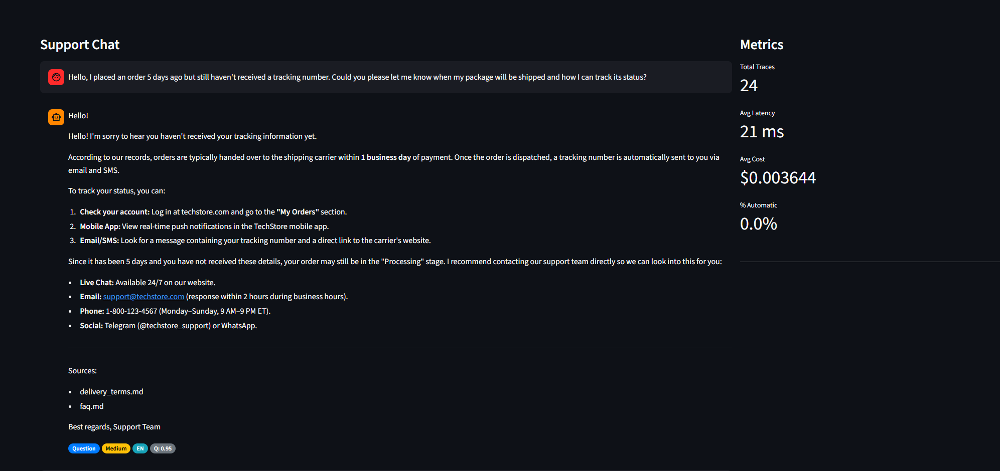
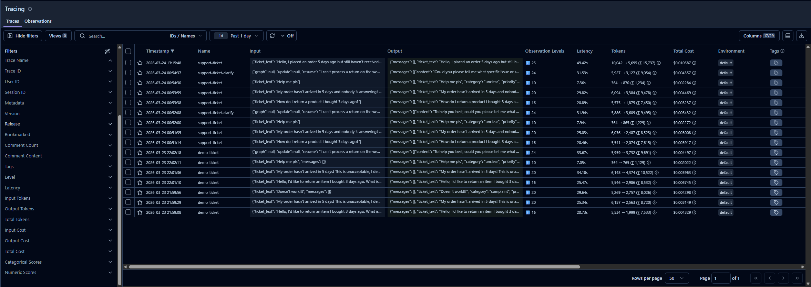
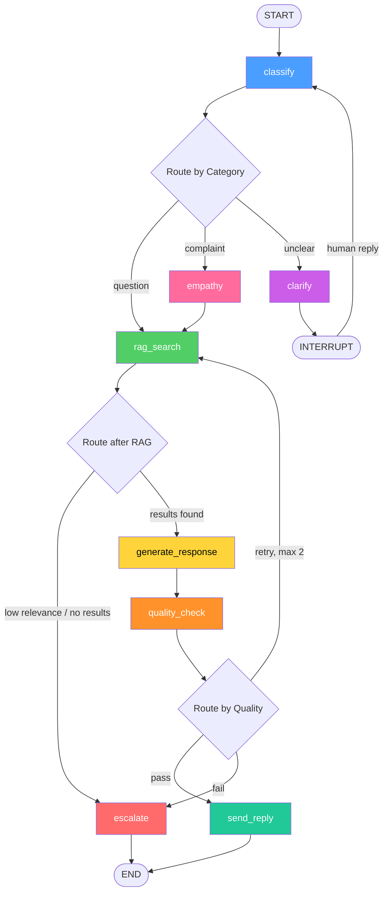
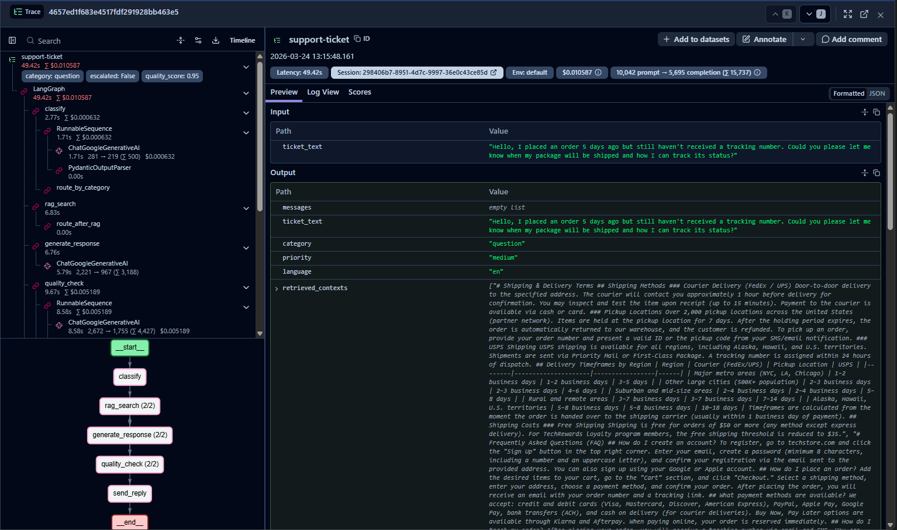

# AI Support Agent


An autonomous AI agent that processes customer support tickets — classifies them, retrieves knowledge base context via RAG, generates responses, and escalates to a human operator when necessary.




---

## Table of Contents

- [Architecture](#architecture)
- [Tech Stack](#tech-stack)
- [Architectural Decisions](#architectural-decisions)
- [Quick Start](#quick-start)
- [API Reference](#api-reference)
- [Testing](#testing)
- [Project Structure](#project-structure)
- [Demo Scenarios](#demo-scenarios)

---

## Architecture

The agent is a LangGraph state machine with **8 nodes** and conditional routing:



### State

The agent state (`AgentState`) is a TypedDict with 14 fields covering:

| Group | Fields |
|---|---|
| **Dialog** | `messages`, `ticket_text` |
| **Classification** | `category`, `priority`, `language` |
| **RAG** | `retrieved_contexts`, `sources` |
| **Generation** | `draft_response`, `quality_score` |
| **Routing / Control** | `needs_escalation`, `escalation_reason`, `iteration_count` |
| **Empathy** | `tone_instructions`, `empathy_preamble` |

---

## Tech Stack

| Component | Technology | Purpose |
|---|---|---|
| **Orchestration** | LangGraph | State machine with conditional routing and cycles |
| **RAG Framework** | LlamaIndex | Document indexing, chunking, retrieval |
| **Vector Database** | Qdrant | Semantic search over knowledge base |
| **LLM** | Google Gemini (2.5 Flash / 3.0 Flash) | Classification, generation, quality checks |
| **Embeddings** | Google GenAI Embeddings | Document and query vectorization |
| **Tracing** | Langfuse | LLM observability, cost tracking, latency metrics |
| **API** | FastAPI + Uvicorn | REST API for ticket processing |
| **UI** | Streamlit | Interactive chat + metrics dashboard |
| **Config** | Pydantic Settings | Type-safe configuration from `.env` |
| **Testing** | pytest | Unit, integration, and end-to-end tests |
| **Infrastructure** | Docker Compose | Local Qdrant, Langfuse, PostgreSQL |

---

## Architectural Decisions

### AR-1: Empathy Separation

The `empathy` node only sets `tone_instructions` and `empathy_preamble` in state — it does **not** perform RAG. All paths (question and complaint) share the same `rag_search → generate → quality_check` pipeline. This avoids code duplication and ensures consistent response quality.

### AR-2: Model Split

- **Gemini 2.5 Flash** — for `classify`, `quality_check`, LLM reranking, and relevance verification (cheaper, structured output)
- **Gemini 3.0 Flash** — for `generate` and `empathy` (better quality for customer-facing text)

This optimizes cost without sacrificing response quality where it matters.

### AR-3: HTTP Boundary

Streamlit communicates with FastAPI via REST (`httpx`), not direct imports. This enforces a clean separation between UI and business logic, making each component independently deployable and testable.

### AR-4: Early Escalation

The RAG pipeline uses a three-layer quality gate to decide whether the knowledge base can answer the question:

1. **SimilarityPostprocessor** — fast cosine similarity filter (cutoff 0.5), removes obviously irrelevant chunks
2. **LLMRerank** — Gemini 2.5 Flash re-scores each chunk on a 1-10 scale; if the best score < 3.0, the agent escalates
3. **LLM Relevance Verification** — a separate LLM call checks whether the retrieved context contains a *direct, specific* answer (not just related information)

If any layer fails, the agent escalates immediately — skipping `generate` and `quality_check`. This prevents hallucinated responses when the knowledge base lacks relevant information.

---

## Quick Start

### Prerequisites

- Python 3.11+
- Docker and Docker Compose (for local infrastructure) **or** cloud accounts for Qdrant and Langfuse
- Google Gemini API key

### 1. Clone and set up the environment

```bash
git clone https://github.com/your-username/support-agent.git
cd support-agent

python -m venv venv

# Windows
venv\Scripts\activate

# Linux / macOS
source venv/bin/activate

pip install -r requirements.txt
```

### 2. Configure environment variables

```bash
cp .env.example .env
```

Edit `.env` with your credentials:

```env
GEMINI_API_KEY=your_gemini_api_key_here

# Option A: Cloud services
QDRANT_URL=https://your-cluster.cloud.qdrant.io
QDRANT_API_KEY=your_qdrant_api_key
LANGFUSE_BASE_URL=https://cloud.langfuse.com
LANGFUSE_SECRET_KEY=sk-lf-...
LANGFUSE_PUBLIC_KEY=pk-lf-...

# Option B: Local services (use with docker-compose)
# QDRANT_URL=http://localhost:6333
# QDRANT_API_KEY=
# LANGFUSE_BASE_URL=http://localhost:3000
# LANGFUSE_SECRET_KEY=sk-lf-...
# LANGFUSE_PUBLIC_KEY=pk-lf-...

QDRANT_COLLECTION_NAME=support-agent
LANGFUSE_ENABLED=true
```

### 3. Start infrastructure (local only)

Skip this step if you use cloud services.

```bash
docker-compose --profile local up -d
```

> **Note:** Wait ~10 seconds for all services to fully initialize before proceeding.

This starts:
- **Qdrant** on `localhost:6333` (vector database)
- **Langfuse** on `localhost:3000` (tracing dashboard)
- **PostgreSQL** on `localhost:5432` (Langfuse backend)

### 4. Index the knowledge base

```bash
python scripts/index_knowledge_base.py
```

This reads markdown files from `data/knowledge_base/`, chunks them (512 tokens, 50 overlap), and indexes them into Qdrant.

### 5. Start the API server

```bash
uvicorn app.main:app --reload
```

API is available at `http://localhost:8000`. Check the interactive docs at `http://localhost:8000/docs`.

### 6. Start the Streamlit UI

In a separate terminal (with the venv activated):

```bash
streamlit run streamlit_app.py
```

UI is available at `http://localhost:8501`.

---

## API Reference

### `GET /health` — Health check

Returns API status and whether the LangGraph agent is ready.

```json
{
  "status": "ok",
  "graph_ready": true
}
```

### `POST /ticket` — Submit a support ticket

**Request:**

```json
{
  "text": "How do I return a product I bought last week?",
  "thread_id": null
}
```

**Response:**

```json
{
  "ticket_id": "abc123",
  "response": "To return a product, you can initiate a return within 14 days...",
  "category": "question",
  "priority": "medium",
  "language": "en",
  "quality_score": 0.85,
  "escalated": false,
  "trace_id": "trace-xyz",
  "needs_clarification": false,
  "clarifying_question": null
}
```

### `POST /ticket/{ticket_id}/clarify` — Resume after clarification

Used when the agent requests more information from the customer (category = `unclear`).

**Request:**

```json
{
  "reply": "I meant I want to return the blue jacket, order #12345"
}
```

### `GET /ticket/{trace_id}/trace` — Get trace details

Returns Langfuse trace data: node execution times, token usage, and costs.

### `GET /metrics` — Aggregated metrics

**Response:**

```json
{
  "total_traces": 142,
  "avg_latency_ms": 3200.5,
  "avg_cost": 0.0023,
  "automation_pct": 78.5,
  "category_distribution": {
    "question": 85,
    "complaint": 42,
    "unclear": 15
  }
}
```

---

## Testing

All tests require the virtual environment to be activated.

```bash
# Run all tests
pytest tests/ -v

# Run a specific test file
pytest tests/test_classification.py -v

# Run a specific test by name
pytest tests/test_e2e.py -v -k "test_question_flow"
```

### Test structure

| File | What it tests |
|---|---|
| `test_classification.py` | Classify node: unit (mocked) + integration (real Gemini API) |
| `test_routing.py` | Routing functions: `route_by_category`, `route_after_rag`, `route_by_quality` |
| `test_response_pipeline.py` | RAG search → generate integration |
| `test_e2e.py` | Full graph execution: question, complaint, unclear flows |
| `test_clarify.py` | Interrupt / resume (human-in-the-loop) flow |
| `test_tracing.py` | Langfuse trace recording and retrieval |

> **Note:** Integration and e2e tests require valid API keys in `.env` (Gemini, Qdrant, Langfuse).

### Smoke test (end-to-end via HTTP)

With the API server running:

```bash
python scripts/smoke_test.py
```

This sends real requests to the API and validates all three flows (question, complaint, unclear + clarify resume) plus the metrics endpoint. Exit code 0 = all passed.

### Manual verification checklist

After the smoke test passes, verify these manually:

- [ ] Streamlit UI loads at `http://localhost:8501`
- [ ] Sending a message in the UI returns a response with category/priority badges
- [ ] Trace timeline chart appears below the response
- [ ] Metrics sidebar shows Total Traces, Avg Latency, Avg Cost, % Automatic
- [ ] Langfuse dashboard shows traces with node-level spans and costs
- [ ] Ticket history table populates at the bottom of the UI

---

## Project Structure

```
support_agent/
├── app/
│   ├── config.py                 # Pydantic Settings (loads .env)
│   ├── main.py                   # FastAPI app with 5 endpoints
│   ├── agent/
│   │   ├── state.py              # AgentState (14-field TypedDict)
│   │   ├── graph.py              # build_graph() — 8-node LangGraph
│   │   ├── routing.py            # Conditional routing functions
│   │   └── nodes/                # One file per graph node
│   │       ├── classify.py       # Ticket classification (Gemini 2.5 Flash)
│   │       ├── empathy.py        # Tone + preamble for complaints (Gemini 3.0 Flash)
│   │       ├── rag_search.py     # Knowledge base retrieval (LlamaIndex)
│   │       ├── generate.py       # Response generation (Gemini 3.0 Flash)
│   │       ├── quality_check.py  # Quality scoring (Gemini 2.5 Flash)
│   │       ├── escalate.py       # Escalation to human operator
│   │       ├── send_reply.py     # Final response formatting
│   │       └── clarify.py        # Human-in-the-loop interrupt
│   ├── rag/
│   │   ├── qdrant_store.py       # Qdrant client + vector store factory
│   │   ├── indexer.py            # Knowledge base indexing pipeline
│   │   ├── llm_settings.py       # LlamaIndex LLM/embedding config
│   │   └── query_engine.py       # Query engine (top_k=10, LLMRerank, no_text mode)
│   └── tracing/
│       ├── langfuse_setup.py     # Langfuse handler + trace context
│       └── metrics.py            # Aggregate metrics + trace retrieval
├── tests/                        # Unit, integration, e2e tests
├── scripts/
│   ├── index_knowledge_base.py   # Qdrant indexing entry point
│   ├── run_demo.py               # 3 demo scenarios with timing
│   ├── smoke_test.py             # End-to-end HTTP smoke test
│   └── test_tracing.py           # Langfuse trace verification
├── data/
│   └── knowledge_base/           # RAG source documents (markdown)
│       ├── faq.md
│       ├── return_policy.md
│       ├── delivery_terms.md
│       └── compensation_rules.md
├── streamlit_app.py              # Streamlit UI (chat + metrics dashboard)
├── docker-compose.yml            # Local infrastructure (Qdrant, Langfuse, PostgreSQL)
├── .env.example                  # Environment variable template
├── requirements.txt              # Python dependencies
└── CLAUDE.md                     # AI assistant instructions
```

---

## Demo Scenarios

Run the demo script to see all three agent flows in action:

```bash
python scripts/run_demo.py
```

### 1. Question flow

> "How do I return a product I bought last week?"

`classify → rag_search → generate → quality_check → send_reply`

The agent classifies the ticket as a question, retrieves return policy information from the knowledge base, generates a helpful response, and sends it.

### 2. Complaint flow

> "I've been waiting for my order for 3 weeks and nobody is responding to my emails!"

`classify → empathy → rag_search → generate → quality_check → send_reply`

The agent detects a complaint, generates empathetic tone instructions, retrieves delivery policy context, and produces a compassionate response with actionable steps.

### 3. Unclear flow

> "It doesn't work"

`classify → clarify → [INTERRUPT — waiting for human input] → classify → ...`

The agent cannot determine the issue, asks a clarifying question, and waits for the customer's reply before reprocessing.

---

## Observability

All agent executions are traced in **Langfuse**. Each trace includes:

- **Node-level timings** — how long each step took
- **Token usage** — input/output tokens per LLM call
- **Cost tracking** — per-trace and aggregate costs
- **Quality scores** — from the quality_check node

Access the Langfuse dashboard:
- **Local:** `http://localhost:3000`
- **Cloud:** `https://cloud.langfuse.com`



---

## License

This project is for educational purposes.
